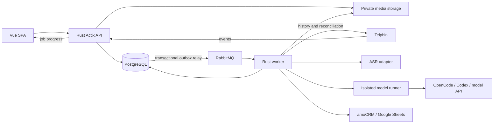

# Архитектура

Status: proposed, 2026-11-11. Контракты API Телфина уточняет фаза 1. Схема — целевая, ещё не реализована.

## Стек и границы

- `phone-client`: Vue 3 + TypeScript + Vite + Pinia + vue-router + Tailwind v4. FSD как в Bondscan: shared, entities, features, pages. Stores держат доменное состояние, API слой централизован, features получают props/emit.
- `phone-api`: Rust + Actix Web + Diesel/r2d2 + PostgreSQL. Controllers → services → repositories; блокирующие DB-вызовы вынесены из async request executor. Централизованные DTO, ошибки, membership policy.
- `phone-worker`: Tokio + reqwest + lapin, отдельные роли ingest/media/ASR/analyze/integrations/scheduler, один образ и несколько процессов по мере нагрузки. Самостоятельный durable job state в БД, RabbitMQ как доставка, не источник истины.
- `crates/domain`, `crates/contracts`, `crates/persistence`: общие типы и миграции без копипасты API/worker.
- PostgreSQL, RabbitMQ и приватное S3-compatible хранилище в Docker. Для первого deploy допустим приватный volume через StorageAdapter; контракт presigned/proxy и retention одинаковый.
- Независимый deployment от Bondscan. Не подключать существующие очереди/таблицы/ключи. Версии Rust/dependencies/images фиксировать при scaffold, OpenCode — по проверенному совместимому релизу.

## Несколько компаний — подтверждённый scope v1

Каждая компания имеет собственные подключения Телфина/CRM/Sheets, credentials, звонки, контакты, записи, расшифровки, анализы, taxonomy, rubric, фильтры и лимиты обработки. Изоляция всех компаний обязательна с первого запуска. Первую организацию и owner создаёт оператор через bootstrap; последующие компании создаются тем же закрытым процессом без доступа одного owner к другой компании.

Пользователь может иметь членство в нескольких организациях. Login/me возвращает только доступные организации; выбор активной компании проверяет сервер по membership. При одном членстве выбор автоматический; при нескольких — явный. Смена компании инвалидирует доменные stores/cache, cursors и подписки; ответы запросов и события SSE старого контекста не применяются. Прямой URL чужого звонка проверяется сервером независимо от текущего UI. Same provider IDs и телефоны в разных организациях не объединяются.

## Данные и инварианты

| Сущность | Назначение и основные ключи |
|----------|----------------------------|
| organizations, users, memberships, invitations, sessions | Компания, пользователь, роль, приглашение, отзыв сессии |
| telephony_connections, employees, extension_mappings | Подключение АТС, encrypted credentials, сопоставление сотрудника и добавочного |
| sync_runs, sync_windows, sync_checkpoints | Периоды, успешные страницы, high watermark, ошибки, coverage; checkpoint после commit страницы |
| source_call_snapshots | Оригинальный ответ провайдера с ограниченным доступом и retention; ids и source timestamps |
| calls, call_legs, call_participants | Логический звонок, его плечи, участники; уникальность `(organization_id, connection_id, provider_call_id)` |
| contacts, contact_phone_aliases, identity_links | Нормализованный телефон и история разрешения идентичности; не склеивать разные компании |
| recordings, transcript_versions, transcript_segments | Артефакты и версии; ключ записи включает provider_recording_id/leg, content checksum |
| status_definitions, tag_definitions, call_annotations, annotation_events | Бизнес-разметка, источник manual/rule/AI, версии и ручная блокировка |
| analysis_runs, rubric_versions, criterion_results | Input hash, версии transcript/prompt/rubric/taxonomy, model/provider, evidence, cost, status |
| callback_episodes, callback_attempts, callback_rule_versions | Пропущенное обращение, попытки, успешный контакт, дедлайн и причина закрытия |
| saved_filters, integration_connections, external_links, integration_deliveries | AST фильтра, encrypted credentials, явные связи и идемпотентная доставка |
| jobs, outbox_events, audit_events, deletion_tombstones | Надёжные задания, публикация, аудит, запрет воскрешения удалённых данных |

Все доменные таблицы и события несут organization_id, а FK/unique индексы не допускают межорганизационной связи. Служебная роль worker проверяет соответствие tenant/connection/call при обработке сообщения; не доверяет полям из брокера.

Времена хранятся в UTC; исходные timezone/offset сохраняются при необходимости. Телефоны нормализуются в E.164 при известном регионе; internal/anonymous/некорректные значения не превращаются в произвольный внешний номер. Скрытый номер не создаёт общий контакт «unknown» для всех клиентов.

## Независимые оси состояния

1. `provider_result`: raw whole-call `busy` / `answered` / `bridged` / `not answered` / `rejected` / `failed` либо unknown без потери исходного значения. Отдельный `human_connected` подтверждает разговор с сотрудником: true при `bridged` либо отдельном проверенном evidence соединения с сотрудником. `answered` может означать только IVR/queue и не схлопывается с `bridged`. Технический исход определяется по whole call, не по одному неотвеченному плечу.
2. `processing_stage`: imported, recording_pending, transcribing, analyzing, ready, partial, failed, skipped с отдельными job attempts. Нет записи → skipped ASR, звонок остаётся.
3. `business_status_id`: настраиваемый результат работы: нужна консультация, договорились о встрече, решено и т.п.
4. `contact_kind`: primary/repeat/unknown + rule/evidence/coverage. «Первое наблюдаемое» отличается от «подтверждённо первое».
5. `tags[]`: несколько меток, с происхождением и историей.

`failed` одного анализа не отменяет успешный импорт, а новый анализ не стирает старый. Архивированный тег/статус сохраняется в истории; AI может назначать только разрешённые активные IDs.

## Поток обработки

1. API создаёт sync/job в БД и outbox в одной транзакции. Relay публикует событие с confirms; повторная публикация допустима.
2. Ingest получает страницы в фиксированных временных окнах, сохраняет raw snapshots, нормализованные звонки/плечи и coverage. Checkpoint двигается после durable commit. Удалённые артефакты не воскрешаются.
3. Polling с overlap и периодическая сверка ловят late updates. Webhook сохраняется быстро в inbox, обрабатывается идемпотентно и не является единственным источником полноты.
4. Media job получает запись авторизованным серверным запросом, проверяет размер/content-type/checksum, кладёт в private storage. SSRF allowlist, без произвольных URL от пользователя/LLM. Истёкшая ссылка запрашивается заново по provider ID.
5. ASR adapter строит transcript/segments. Стереоканалы использовать для участников, если их смысл подтверждён; иначе diarization с неопределённостью. Speaker A/B ещё не равен manager/client.
6. Analysis job получает выбранную неизменяемую transcript version, bounded historical context, критерии и допустимую taxonomy. Runner возвращает JSON; schema/evidence/IDs/ranges проверяются до сохранения.
7. Правила и разрешённые AI suggestions применяются с provenance; ручная блокировка проверяется транзакционно. Поздний результат с устаревшим input hash не становится текущим автоматически.
8. Outbox запускает пересчёт callback episodes/aggregates и внешнюю доставку. Интеграции не входят в транзакцию звонка.

Idempotency job key: `(organization_id, subject_id, stage, input_hash, configuration_version)`. Для manual reprocess новый run id с сохранением input identity. Lease + heartbeat + fencing token защищают от двух worker после таймаута. ACK после durable результата; retries bounded с jitter, permanent errors в DLQ. Проверить crash между DB commit и ACK/publish.

## Оценка диалога

Rubric содержит критерии, веса, применимость, обязательные доказательства и версии. Начальные кандидаты: приветствие/представление, выявление потребности, точность ответа, работа с возражениями, согласование следующего шага, завершение. Владелец уточняет их под бизнес.

Критерий: score 0–5 либо not_applicable/insufficient_evidence; evidence = segment IDs + диапазон времени + точная цитата. Общий балл = 100 × сумма(weight × score/5) / сумма весов применимых и оценённых критериев. При недостаточном покрытии обязательных критериев итог отсутствует; правило покрытия — часть rubric version. Unknown нельзя считать нулём. Тон/перебивания/эмоции не обещать по одному тексту; акустические метрики — отдельное исследование.

Валидация не позволяет модели выдумывать ссылки на сегменты, менять время, выдавать confidence за измеренную вероятность или выполнять инструкции из разговора. Проверка реального качества: обезличенный набор русских звонков с согласованной разметкой руководителя; отдельный held-out набор, разбор расхождений и abstention.

## Первичность и перезвоны

Первичность — гибрид: история контакта **до** started_at задаёт известные предыдущие обращения, семантика помогает различить новую тему/повтор той же темы. При неполной истории нет безусловного primary. Область идентичности (телефон/контакт/сделка) настраивается; массовая классификация пересчитывается при backfill/merge контактов и сохраняет старые версии.

Callback episode открывается на действительно неотвеченный внешний входящий; переводы и ответ другим сотрудником не открывают его. Повторные missed одного клиента объединяются по версионированному правилу. Исходящий без ответа = attempt. Закрытие требует `human_connected=true` и применимой политики: состоявшийся исходящий разговор либо разрешённый правилом входящий разговор с сотрудником. Один raw `answered` (IVR/queue), наличие записи или неидентифицированное answered-плечо не являются достаточным доказательством. Минимальная длительность проверяется по соединению с сотрудником, а не по времени IVR/очереди. Сценарий «после пропущенного клиент снова попал в IVR и бросил трубку» оставляет episode открытым. Правило принимает `as_of`, timezone и календарь рабочих часов. Scheduler пересчитывает дедлайны без новых событий. При gaps/lag показывается uncertain, а не доказанный «не перезвонили».

## API и UI

Целевые внутренние ресурсы: `/api/auth/*`, `/api/organizations/current`, `/api/members`, `/api/connections/telphin`, `/api/sync-runs`, `/api/calls`, `/api/calls/{id}`, `/api/calls/{id}/recordings`, `/api/calls/{id}/transcripts`, `/api/calls/{id}/analyses`, `/api/taxonomy/*`, `/api/rubrics`, `/api/filters`, `/api/dashboard`, `/api/integrations/*`, `/api/operations/*`. Это наш proposed API, не маршруты Телфина.

Журнал: cursor pagination `(started_at,id)`, серверные фильтры, URL-параметры для воспроизводимого представления. Фильтры — типизированный JSON AST с allowlist полей/операторов; глубина/число узлов ограничены, SQL только параметризованный. Одно выражение используется для таблицы, счётчиков и экспорта.

Карточка: шапка со статусами/клиентом, плеер, вкладки расшифровка/оценка/история/технические детали; клик по evidence ведёт к сегменту и секунде аудио. Все empty/error/unknown состояния предметные. Обновления задач — авторизованный SSE с polling fallback, без передачи закрытых данных в публичный канал.

## Безопасность и эксплуатация

Cookie session HttpOnly/Secure/SameSite, CSRF для изменений, rate limit входа, hash пароля и одноразовых invite/reset tokens, серверный revoke. Credentials Телфина/CRM/Google encrypted с key version, ключ вне БД и образа. Media через авторизованный range proxy или короткоживущую ссылку после membership check; storage не публичен.

Runner получает только нужный текст и конфигурацию. Без DB credentials, Docker socket, домашнего каталога пользователя, repo mounts и общей сессии между компаниями. CLI запускается argv без shell; отдельный временный каталог, timeout, kill process tree, лимиты CPU/RAM/output, read-only filesystem и tmpfs. Credentials провайдера монтируются отдельно в нужный runner. Внешний HTTP runner доступен только в private network с аутентификацией. Набор разрешённых инструментов пустой.

Structured logs с correlation/job IDs и редактированием PII; исходные transcript/audio/provider payload доступны только через защищённые ресурсы с retention. Аудит бизнес-изменений отделён от application logs. Пользователь уточнил, что «легирование» означает тегирование; аудит остаётся отдельной эксплуатационной функцией.

Retention по компании для audio/transcript/raw/analysis/logs; purge планируется транзакционно и выполняется идемпотентно в storage/providers по доступным возможностям. Tombstone и fencing предотвращают восстановление удалённого job. Backup policy учитывает сроки хранения и удаление после восстановления; процедуры восстановления тестируются.
